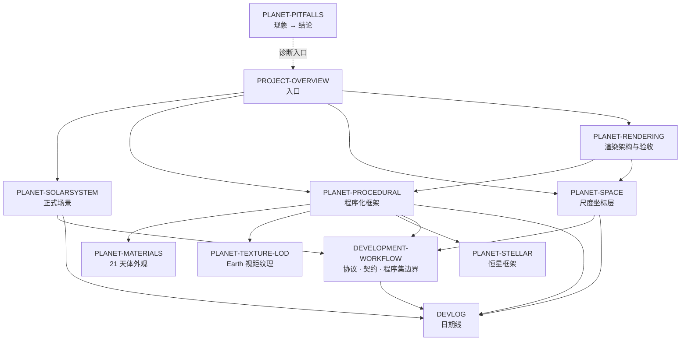

# Planet — 文档地图与写作规则

> 本文件规定**文档怎么写**（§1–§2）与**每件事归谁写**（§3–§5）。
> 改动文档结构时先改本文件。维护流程见 [DEVELOPMENT-WORKFLOW.md](DEVELOPMENT-WORKFLOW.md) §8。

---

## 1. 三层语言：每篇文档只写三样东西

写任何一段之前先问：这句话属于哪一层？不属于这三层的，删。

| 层 | 写什么 | 判据 |
|---|---|---|
| **① 为什么** | 决策、理由、代价、被否决的替代方案 | 读代码读不出来的部分，是文档存在的主要理由 |
| **② 契约** | 不变量、公式、阈值、判据、边界方向 | 会被别的模块依赖、写错就会坏 |
| **③ 入口** | 菜单名、文件名、符号名、命令 | 用来找到代码，一句话说完 |

**不写第四层——实例值。** 具体数字、清单、计数属于代码或工具的**输出**，不是文档的内容。

## 2. 易变量规则（本工程文档精简的核心）

凡是**能被重新导出**的值，都不算知识，写下来只会过期。分两类：

- **哪里都不写**：文件数与行数、测试项数、截图数、磁盘占用、提交哈希与标签、GUID、
  基准资产的体积与计数。文档里出现它们只会变成需要同步维护的谎言。
- **只写在唯一 owner**：菜单项全表、逐天体参数表、资源清单与显存表——它们本身是**契约**
  （第三层「入口」），有检索价值，但**第二处出现一律删除**。owner 由 §4 指定，
  且应写明"用什么重新导出"。

契约常量不受此限（它们是**必须**写死的判据），同样只允许一个 owner，
其它文档只给符号名不给数字。

**推论：文档里出现的任何数字都必须可核对。** 写不进代码位置的常量就不要写数字，改为指向符号名。

踩坑记录单独收口到 [PLANET-PITFALLS.md](PLANET-PITFALLS.md)：专题文档讲机制，不重述现象。

---

## 3. 分层与职责

四层，**下层不引用上层**：

专题之间的唯一强依赖是 `PLANET-PROCEDURAL → {PLANET-MATERIALS, PLANET-TEXTURE-LOD, PLANET-STELLAR}`：
三者都是同一条采样链的**消费者**，因此必须向框架对齐术语，而不是反过来。

| 文档 | 负责 | **不负责**（去这里找） |
|---|---|---|
| [PROJECT-OVERVIEW.md](PROJECT-OVERVIEW.md) | 工程定位、内容线划分、上手顺序、索引指针 | 一切细节与数字 |
| [DEVELOPMENT-WORKFLOW.md](DEVELOPMENT-WORKFLOW.md) | 分支与轮次、**程序集边界与跨程序集接口**、**视场高度契约与阈值**、目录数据规则、合并/验收、文档协议 | 各层实现细节 |
| [DEVLOG.md](DEVLOG.md) | 逐日历史线：哪天做了什么、为什么这么定 | 当前状态、参数、踩坑（都会过期） |
| [PLANET-PITFALLS.md](PLANET-PITFALLS.md) | **全工程唯一**的「现象 → 结论」表，按子系统分组 | 机制解释 → 对应专题文档 |
| [PLANET-SOLARSYSTEM.md](PLANET-SOLARSYSTEM.md) | 正式场景：比例决策、轨道力学与数值验证、操作与菜单、坐标系映射 | 尺度层 → [PLANET-SPACE.md](PLANET-SPACE.md)；外观 → [PLANET-MATERIALS.md](PLANET-MATERIALS.md) |
| [PLANET-SPACE.md](PLANET-SPACE.md) | 尺度坐标层：精度预算、四级架树、浮动原点、分块网格与接缝、策略 LOD/ChunkStreamer、远场策略 | 大气散射与地表采样、正式运行时区块流送 → [PLANET-PROCEDURAL.md](PLANET-PROCEDURAL.md) §16 |
| [PLANET-RENDERING.md](PLANET-RENDERING.md) | 商业级画质路线、跨系统渲染架构、帧时间与独立 Player 验收、性能诊断入口 | 采样与区块预算 → [PLANET-PROCEDURAL.md](PLANET-PROCEDURAL.md) §16；坐标与交互契约 → [DEVELOPMENT-WORKFLOW.md](DEVELOPMENT-WORKFLOW.md) §2–§3 |
| [PLANET-PROCEDURAL.md](PLANET-PROCEDURAL.md) | 程序化框架：设计原则、数据流、单位与坐标、采样数学、网格与壳层、烘焙缓存、分辨率预算、正式运行时地表加载 | 单颗天体的外观解释 → [PLANET-MATERIALS.md](PLANET-MATERIALS.md) |
| [PLANET-MATERIALS.md](PLANET-MATERIALS.md) | 21 个天体的可见光外观、权威/派生资源布局、框架缺口与对策、特征依据 | 采样数学 → [PLANET-PROCEDURAL.md](PLANET-PROCEDURAL.md) |
| [PLANET-TEXTURE-LOD.md](PLANET-TEXTURE-LOD.md) | Earth 按视场高度分级的纹理档位、烘焙与缓存、运行时绑定与显存预算、云层唯一性 | 采样数学 → [PLANET-PROCEDURAL.md](PLANET-PROCEDURAL.md) |
| [PLANET-STELLAR.md](PLANET-STELLAR.md) | 独立恒星定义、光球几何与对流、Planck/CIE 温度辐射、较差自转、观测与曝光边界 | 行星采样与材质 → [PLANET-PROCEDURAL.md](PLANET-PROCEDURAL.md) / [PLANET-MATERIALS.md](PLANET-MATERIALS.md) |
| [MCP-Setup/MCP-HANDSHAKE-REPORT.md](MCP-Setup/MCP-HANDSHAKE-REPORT.md) | 环境搭建：MCP 四方握手、包改动、端口表、备份回滚 | 与工程内容无关，独立子目录 |

`Packages/com.coplaydev.unity-mcp/README.md` 是第三方包自带说明，不属本工程文档体系。

---

## 4. 唯一 owner 表

同一件事**只在一处**写。发现别处有第二份数字、第二张表、第二段解释，**删掉拷贝并改成链接**。

| 主题 | 唯一 owner | 其它文档只能 |
|---|---|---|
| 程序集清单、依赖方向、跨程序集接口（含 C1/C2/C-ratio/C6） | [DEVELOPMENT-WORKFLOW.md](DEVELOPMENT-WORKFLOW.md) §2 | 链接 |
| 玩家近地模式阈值与 `clearanceOverView` / `clearanceOverRadius` 契约 | [DEVELOPMENT-WORKFLOW.md](DEVELOPMENT-WORKFLOW.md) §3 | 给符号名，不给数字 |
| 目录数据（半径/质量/轨道/环）改动的操作顺序 | [DEVELOPMENT-WORKFLOW.md](DEVELOPMENT-WORKFLOW.md) §4 | 链接 |
| 分支、轮次、合并与验收流程 | [DEVELOPMENT-WORKFLOW.md](DEVELOPMENT-WORKFLOW.md) §1、§5–§7 | 链接 |
| 全部「现象 → 结论」与踩坑结论 | [PLANET-PITFALLS.md](PLANET-PITFALLS.md) | 链接 |
| 尺度层精度、`SurfaceChunkGrid` / `ChunkStreamer` 策略参数 | [PLANET-SPACE.md](PLANET-SPACE.md) | 只给结论，不复述数字 |
| 正式运行时 `TerrainLattice`、地表流送/碰撞预算与闸门 | [PLANET-PROCEDURAL.md](PLANET-PROCEDURAL.md) §16 | 只给结论，不复述数字 |
| 商业级画质阶段、性能目标与基准方法 | [PLANET-RENDERING.md](PLANET-RENDERING.md) | 链接；实测结果从基准工具重新导出 |
| 轨道根数来源与数值验证表 | [PLANET-SOLARSYSTEM.md](PLANET-SOLARSYSTEM.md) §2 | 链接 |
| 编辑器菜单全表与操作顺序 | [PLANET-SOLARSYSTEM.md](PLANET-SOLARSYSTEM.md) §6 | 只写要用到的那一项 |
| `PlanetDefinition` 参数分组与采样数学 | [PLANET-PROCEDURAL.md](PLANET-PROCEDURAL.md) §5–§8 | 链接 |
| 地形关联云场、显示起伏倍率、厘米尺度生成与侵蚀边界 | [PLANET-PROCEDURAL.md](PLANET-PROCEDURAL.md) §12、§19 | 链接 |
| Earth 纹理档位与显存分档 | [PLANET-TEXTURE-LOD.md](PLANET-TEXTURE-LOD.md) | 链接 |
| 21 个天体的外观与「解释边界」 | [PLANET-MATERIALS.md](PLANET-MATERIALS.md) §1 | 链接 |
| 恒星光球、黑体辐射、温度 LUT 与观测边界 | [PLANET-STELLAR.md](PLANET-STELLAR.md) | 链接 |
| 星空天空盒的贴图导入契约（逐轴 wrap、经度接缝采样） | [PLANET-SOLARSYSTEM.md](PLANET-SOLARSYSTEM.md) §5 | 链接 |
| 逐日历史 | [DEVLOG.md](DEVLOG.md) | 链接 |

> **两条已知的合理重叠**，不算违规：
> 1. `PLANET-SOLARSYSTEM.md` §1 用一段话概括浮动原点的**动机**，机制与实现属于
>    `PLANET-SPACE.md`——这是「为什么需要这一层」的必要引子，不再展开；
> 2. `PROJECT-OVERVIEW.md` §2 的基本信息表是入口文档的最小必要摘要，细节一律外链。

---

## 5. 引用规则

- **只允许向下或平级引用**，不允许专题文档反向「教学」入口文档；
- 每篇文档开头声明它引用的**上游**文档，结尾不再堆「另见」清单（`PROJECT-OVERVIEW` 除外，它负责分发）；
- 引用**带章节号**（`PLANET-SPACE.md` §11）；文件会变长，章节号让链接可校验。

## 6. 按任务找文档

| 我要做的事 | 从这里开始 |
|---|---|
| 第一次接触这个工程 | [PROJECT-OVERVIEW.md](PROJECT-OVERVIEW.md) §1 → §6（上手顺序） |
| 改某个天体的外观 / 加减天体 | [PLANET-MATERIALS.md](PLANET-MATERIALS.md) §1 → [PLANET-PROCEDURAL.md](PLANET-PROCEDURAL.md) §5、§15 → [DEVELOPMENT-WORKFLOW.md](DEVELOPMENT-WORKFLOW.md) §4 |
| 改采样公式 / 噪声 / 地形 | [PLANET-PROCEDURAL.md](PLANET-PROCEDURAL.md) §5–§8 |
| 改 Earth 的近景纹理档位 | [PLANET-TEXTURE-LOD.md](PLANET-TEXTURE-LOD.md) |
| 改太阳外观 / 加恒星 | [PLANET-STELLAR.md](PLANET-STELLAR.md) |
| 改相机、输入、缩放边界、地表漫游 | [DEVELOPMENT-WORKFLOW.md](DEVELOPMENT-WORKFLOW.md) §3 → `Assets/Scripts/Interaction/` |
| 改尺度精度、原点或 `SurfaceChunkGrid` / `ChunkStreamer` 策略 | [PLANET-SPACE.md](PLANET-SPACE.md) |
| 改正式运行时地表区块、碰撞覆盖或加载预算 | [PLANET-PROCEDURAL.md](PLANET-PROCEDURAL.md) §16 |
| 提升整体画质与性能、运行独立 Player 基准 | [PLANET-RENDERING.md](PLANET-RENDERING.md) §3–§5 |
| 改轨道 / 比例 / 目录数据 | [PLANET-SOLARSYSTEM.md](PLANET-SOLARSYSTEM.md) §2 → [DEVELOPMENT-WORKFLOW.md](DEVELOPMENT-WORKFLOW.md) §4 |
| 改星空天空盒 / 查贴图导入设置 | [PLANET-SOLARSYSTEM.md](PLANET-SOLARSYSTEM.md) §5 → [PLANET-PITFALLS.md](PLANET-PITFALLS.md) §6 |
| 准备合并、开新分支 | [DEVELOPMENT-WORKFLOW.md](DEVELOPMENT-WORKFLOW.md) §1、§5–§7 |
| 想知道某个决定的来龙去脉 | [DEVLOG.md](DEVLOG.md) |
| 遇到一个怪现象 | [PLANET-PITFALLS.md](PLANET-PITFALLS.md) |

## 7. 维护

- **改代码时**：只改受影响文档的 owner 段落；发现别处有同样的数字，那就是要删的拷贝。
- **加文档时**：在 §3 登记职责与不负责范围，在 §4 登记它新拥有的主题，在 §5 补边。
- **删文档时**：从 §3–§5 移除，并检查入边残留（`git grep` 文件名）。
- **`REPORT-*` 是临时文档**：描述某分支「还欠什么」，随该分支合并一起删除。
