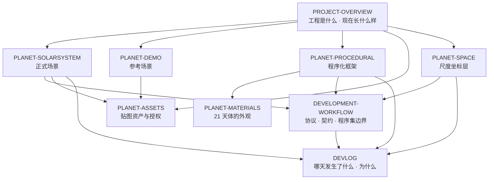

# Planet — 文档索引与引用结构

> 本文件是根目录文档的**地图**：谁负责什么、互相怎么引用、哪些内容不许出现第二份。
> 新增或改动文档时同时更新本文件（规则见 [DEVELOPMENT-WORKFLOW.md](DEVELOPMENT-WORKFLOW.md) §8）。

---

## 1. 按功能分层

四层，**下层不引用上层**：



（同样的关系，纯文本版：`PROJECT-OVERVIEW` 是入口，向下牵引五个专题文档；
`PLANET-PROCEDURAL → PLANET-MATERIALS` 是唯一一条专题之间的强依赖，
因为材质是框架的消费方；四份专题文档都要向 `DEVELOPMENT-WORKFLOW` 对齐契约；
`DEVLOG` 在最底层，只被指向、不指向具体实现。）

---

## 2. 每份文档的职责

| 文档 | 负责 | **不负责**（去这里找） |
|---|---|---|
| [PROJECT-OVERVIEW.md](PROJECT-OVERVIEW.md) | 工程定位、两条内容线、基本信息、目录结构、依赖、场景一览、代码地图、上手顺序 | 任何一条线的细节；具体数字一律外链 |
| [DEVELOPMENT-WORKFLOW.md](DEVELOPMENT-WORKFLOW.md) | 权威分支与轮次、**程序集边界与跨程序集接口清单**、**视场高度契约与阈值**、目录数据规则、提交/合并/验收流程、文档维护协议 | 各层实现细节（指向专题文档） |
| [DEVLOG.md](DEVLOG.md) | 逐日历史线：做了什么、为什么这么定、当轮踩到的坑 | 当前状态与参数（会过期，指向专题文档） |
| [PLANET-SOLARSYSTEM.md](PLANET-SOLARSYSTEM.md) | 正式场景：比例选择、轨道力学与数值验证、场景对象、操作、HUD、程序集边界（§9） | 尺度层内部实现 → [PLANET-SPACE.md](PLANET-SPACE.md)；外观 → [PLANET-MATERIALS.md](PLANET-MATERIALS.md) |
| [PLANET-SPACE.md](PLANET-SPACE.md) | 尺度坐标层：精度预算、四级架树、浮动原点、分块网格与接缝、流式 LOD、远场策略、碎带节奏、审计与回归、**尺度层踩坑表** | 大气散射与地表采样 → [PLANET-PROCEDURAL.md](PLANET-PROCEDURAL.md) |
| [PLANET-PROCEDURAL.md](PLANET-PROCEDURAL.md) | 程序化框架：设计原则、数据流、代码地图、单位与坐标、`PlanetDefinition` 参数、采样数学、烘焙与缓存、**程序化踩坑表** | 21 个天体的外观解释 → [PLANET-MATERIALS.md](PLANET-MATERIALS.md) |
| [PLANET-MATERIALS.md](PLANET-MATERIALS.md) | 21 个天体的可见光外观、权威/派生资源、采样与着色、**框架缺口与对策**、特征依据 | 采样数学 → [PLANET-PROCEDURAL.md](PLANET-PROCEDURAL.md) |
| [PLANET-ASSETS.md](PLANET-ASSETS.md) | NASA 资产来源与授权、派生贴图、**高度图编码**、导入设置、**星空全包围修复**、**显存预算** | 场景怎么用这些资产 → [PLANET-DEMO.md](PLANET-DEMO.md) / [PLANET-SOLARSYSTEM.md](PLANET-SOLARSYSTEM.md) |
| [PLANET-DEMO.md](PLANET-DEMO.md) | 参考场景 `PlanetDemo.unity`：构成、操作、光照、材质、可调参数、星空修复的**验证方式** | 资产来源与编码 → [PLANET-ASSETS.md](PLANET-ASSETS.md) |
| [PLANET-STELLAR.md](PLANET-STELLAR.md) | 独立恒星定义、Planck/CIE 温度辐射、动态光球、较差自转与观测边界 | 行星表面采样与材质 → [PLANET-PROCEDURAL.md](PLANET-PROCEDURAL.md) / [PLANET-MATERIALS.md](PLANET-MATERIALS.md) |
| [REPORT-planet-definition-conflicts.md](REPORT-planet-definition-conflicts.md) | `codex/planet-definition` 分支的**交接单**：并入前需要改什么 | 合并后即删除（见 WORKFLOW §8） |
| [MCP-Setup/MCP-HANDSHAKE-REPORT.md](MCP-Setup/MCP-HANDSHAKE-REPORT.md) | 环境搭建：MCP 四方握手、包改动、端口表、备份回滚 | 与工程内容无关，独立子目录 |

`Packages/com.coplaydev.unity-mcp/README.md` 是第三方包自带的说明，不属本工程文档体系。

---

## 3. 唯一真相表（禁止出现第二份拷贝）

同一件事**只在一处**写。发现别处有第二份数字、第二张表、第二段解释，删掉拷贝并改成链接。

| 主题 | 唯一 owner | 其它文档只能 |
|---|---|---|
| 程序集清单与依赖方向 | [DEVELOPMENT-WORKFLOW.md](DEVELOPMENT-WORKFLOW.md) §2 | 链接 |
| 跨程序集接口清单（含 C1/C2/C-ratio） | [DEVELOPMENT-WORKFLOW.md](DEVELOPMENT-WORKFLOW.md) §2 | 链接 |
| 视场高度契约、`clearanceOverView` / `clearanceOverRadius`、模式阈值 | [DEVELOPMENT-WORKFLOW.md](DEVELOPMENT-WORKFLOW.md) §3 | 链接 |
| 目录数据（半径/质量/轨道/环）改动的操作顺序 | [DEVELOPMENT-WORKFLOW.md](DEVELOPMENT-WORKFLOW.md) §4 | 链接 |
| 提交、合并、验收流程与轮次记录 | [DEVELOPMENT-WORKFLOW.md](DEVELOPMENT-WORKFLOW.md) §5–§7 | 链接 |
| 尺度层的精度数字、分块参数、LOD 与流式参数 | [PLANET-SPACE.md](PLANET-SPACE.md) | 只在需要时给结论，不复述数字 |
| 轨道根数来源与数值验证表 | [PLANET-SOLARSYSTEM.md](PLANET-SOLARSYSTEM.md) §2 | 链接 |
| `PlanetDefinition` 参数分组与采样数学 | [PLANET-PROCEDURAL.md](PLANET-PROCEDURAL.md) | 链接 |
| 21 个天体的外观与"解释边界" | [PLANET-MATERIALS.md](PLANET-MATERIALS.md) §1 | 链接 |
| 恒星光球、黑体辐射、温度 LUT 与观测边界 | [PLANET-STELLAR.md](PLANET-STELLAR.md) | 链接 |
| 实测数据来源、授权、高度图解码公式 | [PLANET-ASSETS.md](PLANET-ASSETS.md) | 链接 |
| 贴图/显存预算表 | [PLANET-ASSETS.md](PLANET-ASSETS.md) | 链接，不重算 |
| 星空「只有一半有星星」的成因与修复 | [PLANET-ASSETS.md](PLANET-ASSETS.md) §4.2（成因）/ [PLANET-DEMO.md](PLANET-DEMO.md) §3.1（验证） | 链接 |
| 编辑器菜单 `Tools ▸ Planet` 全表 | [PROJECT-OVERVIEW.md](PROJECT-OVERVIEW.md) §8 | 链接 |
| 逐日历史 | [DEVLOG.md](DEVLOG.md) | 链接 |
| 通用踩坑表（MCP / 资产 / asmdef） | [DEVLOG.md](DEVLOG.md) | 链接 |
| 程序化侧踩坑表 | [PLANET-PROCEDURAL.md](PLANET-PROCEDURAL.md) | 链接 |
| 尺度层踩坑表 | [PLANET-SPACE.md](PLANET-SPACE.md) §11 | 链接 |

> **两条已知的合理重叠**，不算违规：
> 1. `PLANET-SOLARSYSTEM.md` §1 用一段话概括浮动原点的**动机**，机制与实现属于
>    `PLANET-SPACE.md`——这是"为什么需要这一层"的必要引子，不再展开；
> 2. `PROJECT-OVERVIEW.md` §2 的"基本信息"表与 `PROJECT-OVERVIEW.md` §7 的场景一览，
>    是入口文档的最小必要摘要，细节一律外链。

---

## 4. 引用图（谁指向谁）

```text
PROJECT-OVERVIEW ──┬─► PLANET-SOLARSYSTEM ──┬─► PLANET-SPACE ──┐
                   │                        ├─► PLANET-MATERIALS │
                   │                        ├─► PLANET-PROCEDURAL ┤
                   │                        └─► PLANET-ASSETS ────┤
                   ├─► PLANET-DEMO ─────────────► PLANET-ASSETS ──┤
                   ├─► PLANET-PROCEDURAL ───────► PLANET-MATERIALS │
                   ├─► PLANET-SPACE ──────────────────────────────┤
                   ├─► PLANET-ASSETS ─────────────────────────────┤
                   ├─► PLANET-MATERIALS                            │
                   └─► PLANET-STELLAR                              │
                                                                   ▼
                              DEVELOPMENT-WORKFLOW ◄── （上述各文档都引用其契约章节）
                                       │
                                       ▼
                                    DEVLOG
```

规则：

- **只允许向下或平级引用**，不允许专题文档反向"教学"入口文档；
- 每个文档开头都给出它引用的**上游**文档，结尾不再堆"另见"清单（`PROJECT-OVERVIEW` 除外，
  它是入口，负责分发）；
- 引用要带**章节号**（`PLANET-SPACE.md` §11），不要只给文件名——文件会变长，章节号让链接可校验。

---

## 5. 按任务找文档

| 我要做的事 | 从这里开始 |
|---|---|
| 第一次接触这个工程 | [PROJECT-OVERVIEW.md](PROJECT-OVERVIEW.md) §1 → §12（上手顺序） |
| 改某个天体的外观 / 加减天体 | [PLANET-MATERIALS.md](PLANET-MATERIALS.md) §1–§2 → [DEVELOPMENT-WORKFLOW.md](DEVELOPMENT-WORKFLOW.md) §4 |
| 改采样公式 / 噪声 / 地形 | [PLANET-PROCEDURAL.md](PLANET-PROCEDURAL.md) §5–§7 |
| 改相机、输入、缩放边界 | [DEVELOPMENT-WORKFLOW.md](DEVELOPMENT-WORKFLOW.md) §3 → `Assets/Scripts/Interaction/` |
| 改精度、原点、分块、LOD | [PLANET-SPACE.md](PLANET-SPACE.md) |
| 改轨道 / 比例 / 目录数据 | [PLANET-SOLARSYSTEM.md](PLANET-SOLARSYSTEM.md) §2 → [DEVELOPMENT-WORKFLOW.md](DEVELOPMENT-WORKFLOW.md) §4 |
| 换贴图 / 查授权 / 导入设置 | [PLANET-ASSETS.md](PLANET-ASSETS.md) |
| 准备合并、开新分支 | [DEVELOPMENT-WORKFLOW.md](DEVELOPMENT-WORKFLOW.md) §1、§5–§6 |
| 想知道某个决定的来龙去脉 | [DEVLOG.md](DEVLOG.md) |
| 遇到一个怪现象 | 先查三张踩坑表：[DEVLOG.md](DEVLOG.md) / [PLANET-PROCEDURAL.md](PLANET-PROCEDURAL.md) / [PLANET-SPACE.md](PLANET-SPACE.md) §11 |

---

## 6. 维护

- **改代码时**：只改受影响文档的 owner 段落；如果你发现别处有同样的数字，那就是要删的拷贝。
- **加文档时**：在本文件 §2 登记职责与不负责范围，在 §3 登记它新拥有的主题，在 §4 补边。
- **删文档时**：从本文件 §2–§4 移除，并检查是否有入边残留（`git grep` 文件名）。
- **`REPORT-*` 是临时文档**：它描述某个分支"还欠什么"，随该分支合并一起删除。
