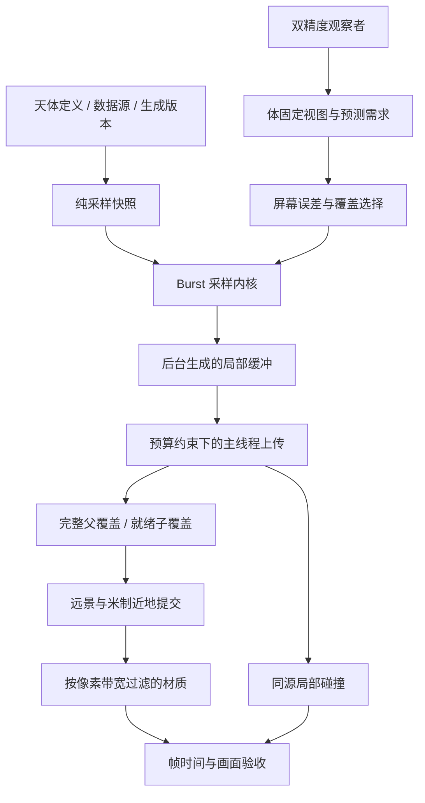

# Planet - 商业级渲染架构与验收

> 上游：[PROJECT-OVERVIEW.md](PROJECT-OVERVIEW.md)。
> 本文拥有跨系统的画质路线、性能验收方法和诊断入口；采样、区块预算与坐标契约仍归各专题。
> SpaceEngine 是体验目标，不代表本工程已经达到其画质、内容覆盖或性能。

## 1. 产品目标与边界

目标是同一个观察者从太阳系尺度连续进入可探索地表，在固定硬件上维持可预测的帧时间。
验收分辨率、目标帧时间和采样容量以 `PlanetPerformanceCapture` 的常量为准。
硬件、驱动、实际分辨率、渲染比例和测量环境由每次报告导出，不在本文保存实例数据。

工程继续使用现有 Unity LTS / URP、定义资产和单向程序集边界。单纯换管线不能解决无限尺度、
地貌结构和流送背压；先让数据来源、资源生命周期和画面误差具备可验证的边界。

当前能够复用的是双精度观察者、天体目录、六面整数格点、父覆盖兜底、米制近地相机、
同源显示几何与碰撞，以及可重建的派生缓存。正式运行时地形的 owner 是
[PLANET-PROCEDURAL.md](PLANET-PROCEDURAL.md) §16；尺度审计路径的边界见
[PLANET-SPACE.md](PLANET-SPACE.md) §11。

## 2. 数据与提交架构



图中的 Burst 是现有 `Task` / `Parallel.For` 调用的纯函数内核，并非已经迁移到 Jobs / ECS。
入口是 `TerrainSamplingKernels`；生成、上传和提交的 Profiler 标记分别在
`RuntimeTerrainChunk` 与 `RuntimeTerrainRenderer`。

依赖方向、观察者所有权与跨程序集接口仍以
[DEVELOPMENT-WORKFLOW.md](DEVELOPMENT-WORKFLOW.md) §2–§3 为准。渲染消费者接收观察状态，
不能回读浮点 Camera Transform 来重建玩家真值，也不能通过导航焦点选择近地碰撞对象。

以下边界必须贯穿后续扩展：

- 种子、基础地貌和海岸不随视距改变；LOD 只分配可解析频段、几何和纹素带宽。
- 物理高程、显示位移、海面和碰撞保持各自语义；不能让法线效果成为碰撞高度。
- 全局位置在 double 域完成减法和旋转，再提交相对区块的 float 米制缓冲。
- 基础采样、细节采样、区块几何和未来缓存格式分别带版本；算法变化必须使对应缓存失效。
- 工作队列、待上传缓冲、驻留资源和碰撞资源都要有上限；超预算时保留粗覆盖。
- 上传预算是不可抢占操作的准入限制；单次 Mesh 上传和 Collider 烹饪仍必须单独测量。

## 3. 已落地的基础改造

### 3.1 编译采样热点

`TerrainSamplingKernels` 将宏观高度、反照率、完整表面样本和双精度细节编译为 Burst 直接调用。
禁用 Burst 时保留托管回退。采用严格浮点模式，采样器中的布尔字段显式声明 ABI 布局；
不引入 Unity 对象、共享随机状态或平台特有噪声实现。

全球网格和运行时区块共用这组内核。全频 CPU 查询仍保留 double 米制细节；测试对照原始
托管采样器，并覆盖不同表面类型和不同细节间距。实现与采样数学见
[PLANET-PROCEDURAL.md](PLANET-PROCEDURAL.md) §6–§9、§16.4。

宏观 float 噪声在 Mono 与 Burst 后端之间不保证逐位相同，回归容差以
`TerrainSamplingKernelTests` 为准；这与厘米细节的 double 误差是两个判据。
编辑器中在后台任务启动前同步预热，Player 使用 AOT 内核，避免同一轮流送因异步编译中途
切换采样后端。运行过程中切换 Burst 调试设置仍应重新建立区块覆盖。

### 3.2 层级边界一致性

子块边界重建父块已经混合过的高度场，继续追溯必要的祖先，避免用未混合的父频段替代
显示父块。区块缓存包含 `RuntimeTerrainChunk.GeometryVersion`。

这一改造保证共享格点的高度一致；裙边和完整父覆盖仍是当前实现的一部分。
所有细边顶点严格落在粗边三角形上、完整的时间几何形变和法线跨 LOD 连续性仍需要后续实现，
不能把共享顶点测试解释成所有接缝问题都已解决。

### 3.3 材质带宽与诊断

近地细节使用同一次 Simplex 求值的解析梯度生成法线，并在像素足迹的 Nyquist 带附近平滑过滤。
未解析的几何频段可以进入材质；低于像素可辨范围的频段不继续计算，也不保留闪烁的颜色变化。
该法线叠加在已有地形法线上，保留已解析的山体坡面。
噪声格点由整数高位与局部低位残差计算，区块提前在 double 域计算径向偏移，
防止高低位原点重新相加或巨量半径相减后丢失近地材质的小位移。

`RuntimeTerrainRenderer` 发布构建、上传、更新和提交耗时；完成的区块在上传准入失败时保留到
后续帧。`PlanetPerformanceCapture` 提供帧时间分位数和资源状态，不用单个平均 FPS 代表流送质量。

## 4. 后续落地顺序

下列阶段尚未完成。每阶段同时通过画面检查和上一阶段的性能回归，才进入下一阶段。

| 阶段 | 实施内容 | 完成判据 |
|---|---|---|
| 资源与提交 | 生成/选择/上传/碰撞分离队列；有界缓冲池；按字节计算驻留；可取消请求；按视锥和距离裁剪提交；MeshData / Jobs 与实例化逐项对比 | 高速飞行和换天体时内存受限，关键覆盖优先，稳定视角不反复创建资源；新增路径有原实现对照 |
| 连续地形 | 相邻层级平衡、粗边精确匹配、时间形变、区域高度/法线缓存；宏观地貌与高频残差分开流送 | 地平线、六面接缝、层级切换和接触带连续，加载滞后不露洞或改海岸；碰撞和显示一致 |
| 表面材料 | 局部材质页 / 虚拟纹理或 clipmap；岩性、坡度、湿度、雪线驱动的多层 PBR；材质频段独立于网格层级 | 近地不依赖全球低频顶点颜色；相同地点在连续高度观察时材质稳定，纹素密度和显存受预算约束 |
| 光学与阴影 | 大气透射/散射 LUT、空中透视、统一曝光；米制近地阴影；天体遮挡采用解析求交；再接低分辨率体积云和历史重投影 | 太空到地表、昼夜与晨昏连续；太阳与山体遮挡正确；固定机位 GPU 成本与 LUT 误差可测 |
| 可信地貌 | 带 halo 的区域侵蚀 / 排水网络缓存；统一流域和边界条件；独立湖泊/河流模型；需要真实地图的天体接观测数据 | 地貌有结构，水系具备连通与溢流语义；跨区块和跨 LOD 不重新随机生成地理 |
| 生产验收 | 多机型质量配置、存档与内容版本迁移、持续基准、长时内存与高速航行回归 | 独立 Player 的预定义场景与移动路线通过帧时间、内存、视觉及数值验收 |

大气可从成熟的预计算散射实现接入，例如
[Bruneton 的预计算大气散射参考实现](https://github.com/ebruneton/precomputed_atmospheric_scattering)，
同时保留许可证、单位转换和参考图像误差验证。近地阴影只能在米制相机的尺度内使用常规阴影图，
不能重新开启太阳系尺度下已经失效的级联阴影。侵蚀与水体的契约见
[PLANET-PROCEDURAL.md](PLANET-PROCEDURAL.md) §19。

银河尺度的数据源、星表层级和星系内容流送属于额外产品范围；当前双精度架树能表示坐标，
不等于已经具备这些内容。增加数据源前，先完成太阳系到地表这一条可测路径。

## 5. 可重复验收

`PlanetPerformanceAuditor` 可采集当前 Play 视角或生成独立 Windows Player。
菜单名只登记在 [PLANET-SOLARSYSTEM.md](PLANET-SOLARSYSTEM.md) §6。

独立 Player 使用 `-planet-benchmark` 启动测试，支持 `EarthOrbit`、`EarthSurface`、
`MoonSurface` 和 `Current`。固定机位恢复真实比例并冻结在目录纪元，采样器确定近地落点；
这验证静态机位，不能替代高速航行、连续换焦点和长时间驻留的路线测试。

```powershell
& '.\Build\PlanetBenchmarkPlayer\Planet.exe' `
  -screen-fullscreen 0 -screen-width 1920 -screen-height 1080 `
  -planet-benchmark EarthSurface `
  -planet-benchmark-warmup 15 -planet-benchmark-seconds 10 `
  -planet-benchmark-output 'D:\UnityProjects\Planet\Library\EarthSurface.json' `
  -planet-benchmark-image 'D:\UnityProjects\Planet\Library\EarthSurface.png'
```

报告使用 JSON 保存环境和帧时间分布，完成后退出基准 Player。窗口实际尺寸与 URP renderScale
必须满足代码中的目标；分辨率不符时即使帧时间低，也不会标记为达到采样目标。
报告还验证采样期间主相机确实逐帧渲染；隐藏或最小化窗口导致的空循环不能标记为达标。
GPU 时间不可用时明确记录不可用，不能把空结果解释为 GPU 没有开销。

基准的限制必须与结果一起保留：

- 编辑器报告只能用于定位和回归；最终性能结论需要独立 Player。
- 静止机位通过不代表动态路线通过；预热后的采样不包含冷启动和初次流送尖峰。
- 帧时间分位数、GPU 时间、区块数量和待处理请求要一起解释；测量期间仍在加载的画面不能当完整画质。
- 确认截图非空、细节没有关闭、机位正确；数值快但没有渲染目标内容不算验收。
- 稳态 GC、资源上限、冷启动、暂停恢复、快速换天体和长时运行仍是生产闸门，不能由单次静态采样替代。

每次报告放在 `Library`，不入版本控制。本文不保存实测时间或截图清单，复测后以新报告为准。
